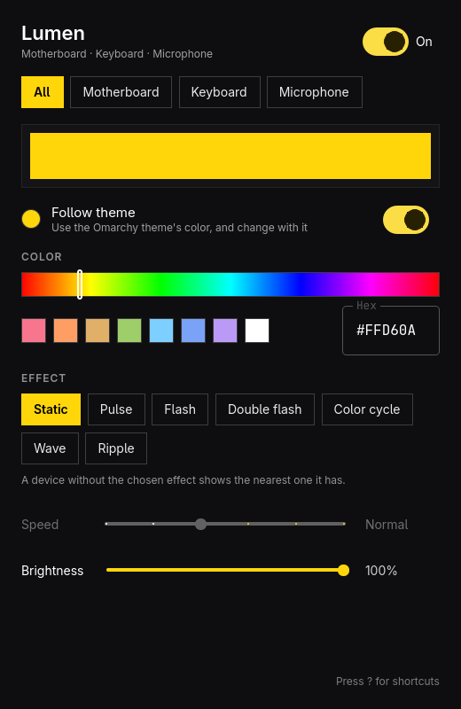

# Lumen



Lumen controls RGB lighting on Linux from one small app: a motherboard LED
strip, a Logitech keyboard, and a Logitech microphone. It also shows the
battery of wireless devices such as a Logitech mouse, in the window and the
Omarchy bar, and warns before it runs out. It has a window, a
command line, and Omarchy hooks. The lights follow the Omarchy theme: switch
themes and they change with it, and they come back after a reboot.

It is built the way Omarchy's own apps are: C++ and Qt Quick, one binary,
keyboard first, and installed as an Arch package so it shows up in the app
launcher.

## Contents

- [Supported hardware](#supported-hardware)
- [Features](#features)
- [Install](#install)
- [Using the window](#using-the-window)
- [Using the command line](#using-the-command-line)
- [Effects](#effects)
- [Following the theme](#following-the-theme)
- [Mouse battery](#mouse-battery)
- [After a reboot](#after-a-reboot)
- [How it works](#how-it-works)
- [Files](#files)
- [Troubleshooting](#troubleshooting)
- [Development](#development)
- [Credits and license](#credits-and-license)

## Supported hardware

| Device | USB ID | How Lumen reaches it |
| --- | --- | --- |
| Gigabyte RGB Fusion 2.0 controller (Z790 AORUS boards and others) | `048d:5702` | [liquidctl](https://github.com/liquidctl/liquidctl) |
| Logitech G515 RAPID TKL keyboard | `046d:c363` | HID++ 2.0, feature RGB EFFECTS (`0x8071`) |
| Logitech Yeti Orb microphone | `046d:0ad5` | HID++ 2.0, feature RGB EFFECTS (`0x8071`) |

Lumen talks to these devices and nothing else. A device that isn't plugged in
is skipped: it shows as "not connected" and keeps its saved settings for when
it comes back.

Other Logitech devices that offer RGB EFFECTS (`0x8071`) speak the same
protocol and should need only a new entry in the device list (see
[Adding a device](#adding-a-device)). Mice without lighting, such as the PRO X
Superlight 2, have nothing to control.

## Features

- **Every light from one place**, or each device on its own. Each device keeps
  its own saved state, so the keyboard can pulse while the strip stays static.
- **Effects:** static, pulse, flash, double flash, color cycle, wave and
  ripple. A device that lacks the chosen effect shows the nearest one it has.
- **On and off** for any device, keeping the last setting for when it's turned
  back on.
- **Color** from a hue strip, the current theme's palette, a hex value, or a
  name like `teal`.
- **Speed and brightness** for every device.
- **Follow the theme:** use the Omarchy theme's lighting color and change with
  it.
- **Restore after boot**, since the devices forget their colors when power is
  lost.
- **Keyboard driven:** every control has a shortcut, and `?` lists them.
- **Mouse battery** in the window and the Omarchy bar, with a notification
  when it's low.
- **Scriptable:** every command takes `--json` and exits 1 with the reason on
  stderr when something fails.
- **No root:** udev rules from liquidctl and Solaar give the desktop user
  access to the devices.

## Install

Lumen is built for [Omarchy](https://omarchy.org) (Arch Linux with Hyprland),
but runs anywhere Qt 6 does. The theme and hook features need Omarchy.

### 1. Dependencies

```sh
omarchy pkg add liquidctl solaar      # or: sudo pacman -S liquidctl solaar
```

- **liquidctl** drives the motherboard controller. Its udev rule
  (`71-liquidctl.rules`) gives the logged-in user access to it.
- **Solaar** is only needed for its udev rule
  (`42-logitech-unify-permissions.rules`), which gives the logged-in user
  access to Logitech devices. Lumen doesn't run Solaar, and Solaar doesn't
  start at login.

The battery features also use `libnotify` (`notify-send`) and `jq`. Building
needs `qt6-base`, `qt6-declarative`, `qt6-wayland`, `gcc` and `make`. Omarchy
already includes all of these.

### 2. Build and install

```sh
git clone https://github.com/orhunakkan/lumen.git
cd lumen
bin/install          # builds the package and installs it with makepkg -fsi
```

Lumen now appears in the app launcher (`Super + Space`), and `lumen` is on
your `PATH`.

### 3. Hooks (Omarchy)

```sh
lumen hooks install
```

This adds two scripts to Omarchy's hook directories:

| Hook | Runs | Does |
| --- | --- | --- |
| `~/.config/omarchy/hooks/theme-set.d/50-lumen` | After every theme change | `lumen apply --if-following` |
| `~/.config/omarchy/hooks/post-boot.d/50-lumen` | About 2 seconds after the desktop starts | `lumen apply --init` |

`lumen hooks uninstall` removes them. Both scripts do nothing if Lumen has
been uninstalled.

### 4. Battery alerts and bar widget (optional)

```sh
lumen battery alerts on   # notify when the mouse battery is low
lumen battery bar on      # show it in the Omarchy bar
```

See [Mouse battery](#mouse-battery).

## Using the window

Open it from the launcher, or with `lumen open`.

- **Device tabs** (All, Motherboard, Keyboard, Microphone) choose which lights
  the controls change. All changes every device at once and shows the
  motherboard's settings. A tab for a device that isn't plugged in is dimmed,
  but can still be set up for later.
- **The power switch** turns the chosen lights on or off.
- **The preview** shows the color at its brightness, moving the way the effect
  moves.
- **Follow theme** uses the theme's lighting color, shown in the dot beside it.
- **Color:** click or drag on the hue strip, click a swatch from the theme's
  palette, or type a hex value and press Enter. Picking a color turns Follow
  theme off.
- **Effect, speed and brightness** apply right away. Dragging a slider or the
  hue strip updates the lights as you move.

If a device or tool is missing, or a write fails, a red banner says what went
wrong.

### Shortcuts

| Key | Action |
| --- | --- |
| Space | Turn the lights on or off |
| T | Follow the theme's color |
| `[` `]` | Previous or next device |
| 1 – 7 | Pick an effect, in the order shown |
| ← → | Brightness down or up |
| ↓ ↑ | Slower or faster |
| ? | Show or hide shortcuts |
| Q, Esc | Quit |

## Using the command line

```text
lumen <command> [--device board|keyboard|mic] [options]
```

| Command | What it does |
| --- | --- |
| `lumen open` | Open the window |
| `lumen status` | Show what each device is set to, and whether it's connected |
| `lumen on` / `off` / `toggle` | Turn the lights on (as last set) or off |
| `lumen color ff5500` | A static color, as hex (`ff5500`, `#ff5500`) or a name (`teal`) |
| `lumen mode pulse` | Pick an effect (see [Effects](#effects)) |
| `lumen mode pulse --speed faster` | An effect and its speed together |
| `lumen speed slower` | `slowest`, `slower`, `normal`, `faster`, `fastest`, `ludicrous` |
| `lumen brightness 40` | Dim the lights, 0–100 |
| `lumen theme on` / `off` | Follow the theme's color, or keep your own |
| `lumen apply` | Put the saved state back on the devices |
| `lumen apply --init` | The same, initializing the motherboard controller first |
| `lumen release` | Hand Logitech lighting back to the device firmware |
| `lumen hooks install` / `uninstall` | Add or remove the Omarchy hooks |
| `lumen battery` | Show wireless device batteries |
| `lumen battery --bar` | The same, as JSON for an Omarchy bar module |
| `lumen battery check` | Notify if a battery just went low (what the alert timer runs) |
| `lumen battery alerts on` / `off` | Turn low-battery notifications on or off |
| `lumen battery bar on` / `off` | Add the battery to the Omarchy bar, or take it off |
| `lumen help` | Show usage |

**Choosing devices.** Without `--device`, a command changes every device.
`--device` takes `board`, `keyboard` or `mic` (also `motherboard`, `strip`,
`kb`, `microphone`, `yeti`). Give several with commas or by repeating the
flag:

```sh
lumen off --device mic
lumen mode wave --device keyboard
lumen color teal --device board,mic
```

**Options.** `--json` prints machine-readable output, and `--quiet` prints
nothing. On failure, every command exits 1 with the reason on stderr; bad
input is rejected before anything is saved.

```console
$ lumen status
Motherboard: fixed #7aa2f7 (theme), brightness 100%
Keyboard:    pulse (for flash) #7aa2f7, speed normal, brightness 100%
Microphone:  not connected

$ lumen status --json --device keyboard
{"devices":{"keyboard":{"brightness":100,"color":"#7aa2f7","connected":true,"effectiveMode":"pulse","followTheme":true,"mode":"flash","on":true,"speed":"normal"}},"ok":true,"themeColor":"#7aa2f7"}
```

**Keybindings.** Commands work well from Hyprland bindings, for example in
`~/.config/hypr/bindings.lua`:

```lua
o.bind("SUPER + CTRL + L", "Toggle lights", "lumen toggle --quiet")
```

## Effects

| Effect | Motherboard | Keyboard | Microphone |
| --- | --- | --- | --- |
| `fixed` (static) | ✓ | ✓ | ✓ |
| `pulse` (breathing) | ✓ | ✓ | ✓ |
| `flash` | ✓ | pulse | pulse |
| `double-flash` | ✓ | pulse | pulse |
| `color-cycle` | ✓ | ✓ | ✓ |
| `wave` | color cycle | ✓ | color cycle |
| `ripple` (reacts to typing) | static | ✓ | static |

Where a device lacks an effect, it shows the one in the table, and
`lumen status` says so: `pulse (for flash)`. The chosen effect is still
saved, so picking it on All doesn't lose it on the devices that have it.

- **Speed** maps to each device's own timing, so a shared speed looks alike
  everywhere.
- **Brightness** scales the color for effects that show one. Color cycle and
  wave have no color, so on the Logitech devices brightness sets their
  intensity, and on the motherboard it has no effect.
- **Picking a color** while color cycle or wave is running switches to static.

Mode names are forgiving: `static`, `solid`, `breathing`, `cycle` and
`rainbow` work too.

## Following the theme

While Follow theme is on, a device shows the theme's lighting color:

1. the theme's `keyboard.rgb`, when it ships one (Tokyo Night's is magenta,
   `ff00ff`);
2. otherwise the theme's `accent` from `colors.toml`.

Both come from `~/.local/state/omarchy/current/theme/`. On a theme change the
`theme-set` hook recolors every device that is on and following the theme,
with an effect that shows a color. Lights you turned off stay off, and
devices with their own color are left alone.

The window follows the theme too: its accent, its palette swatches and its
corner rounding all match the current theme, live.

## After a reboot

The devices lose their lighting when they lose power, and fall back to their
own default lighting. The `post-boot` hook runs `lumen apply --init` once the
desktop starts, which initializes the motherboard controller and puts every
device's saved state back. Expect the default lighting for a few seconds
during boot.

Suspend does the same to the motherboard controller: it wakes on its own
default lighting and quietly ignores writes until it's initialized again.
Omarchy has no resume hook, so the package ships a user service,
`lumen-resume.service`, that watches logind's `PrepareForSleep` signal and
runs `lumen apply --init` when the machine wakes. `lumen hooks install`
enables it and `lumen hooks uninstall` disables it.

A device that's unplugged and plugged back in also returns to its own lighting
until the next `lumen apply` or change from Lumen.

## Mouse battery

Logitech's kernel driver reports the battery of each paired wireless device
in `/sys/class/power_supply/hidpp_battery_N`. Lumen reads that, so it needs
no access to the device and sends it nothing. Any device with a battery shows
up: today a PRO X Superlight 2 mouse, tomorrow a wireless keyboard or headset.
A laptop's own battery is left to Omarchy.

```console
$ lumen battery
Logitech PRO X 2: 54%, discharging
```

**In the window**, a card at the top shows each device's charge as a bar,
refreshed every 30 seconds:

| Level | Bar | Says |
| --- | --- | --- |
| Above 20% | Accent color | On battery |
| 20% and below | Amber | Charge it soon |
| 10% and below | Red | Charge it now |
| Charging | Accent color | Charging |
| Asleep or off | Empty | Not connected |

**In the Omarchy bar**, `lumen battery bar on` adds a command module to
`~/.config/omarchy/shell.json`, just before the Bluetooth icon:

```json
{ "id": "lumen.battery", "type": "command", "exec": "lumen battery --bar",
  "interval": 60, "tooltip": "Mouse battery", "onClick": "lumen open" }
```

It shows a mouse icon and the percentage (a charging icon while charging),
turns the accent color at 20% and below, opens Lumen when clicked, and hides
while the mouse sleeps. The edit goes through `jq`, so the rest of the file
keeps its order and formatting, and `lumen battery bar off` takes it out
again, leaving the file as it was.

**Notifications.** `lumen battery alerts on` enables a systemd user timer
(`lumen-battery.timer`, shipped with the package) that runs
`lumen battery check` two minutes after login and every five minutes after
that. It sends a desktop notification once when a battery drops to 15%, and a
critical one at 5%. Charging the device resets it, so the next drop is
announced again. What's been announced is kept in
`~/.local/state/lumen/battery-alerts.json`.

The kernel updates the level whenever the device reports it, which a
sleeping mouse doesn't do; the last known level stays until it wakes.

## How it works

```text
            ┌───────────── lumen ─────────────┐
 window ───▶│ Lighting: saved state per device │──▶ liquidctl ──▶ RGB Fusion 2.0 (USB HID)
 CLI ──────▶│ ~/.config/lumen/state.json       │
 hooks ────▶│                                  │──▶ HidppLight ─▶ /dev/hidrawN ─▶ G515, Yeti Orb
            └──────────────────────────────────┘
```

**State first.** Every change is saved before it's applied, atomically (write
beside the file, then rename). The window, the CLI and the hooks all read the
same file, and an open window updates when the CLI changes it.

### Motherboard

Lumen runs liquidctl:

```sh
liquidctl --match "RGB Fusion" set sync color fixed ff5500
liquidctl --match "RGB Fusion" set sync color pulse ff5500 --speed faster
liquidctl --match "RGB Fusion" set sync color off
```

`--match "RGB Fusion"` keeps it from touching other liquidctl devices, such as
an AIO cooler. The `sync` channel sets every header at once. The controller
ignores its brightness byte, so Lumen scales the color instead. If a write
fails, Lumen runs `liquidctl initialize` and tries once more, since the
controller needs it after a cold boot. In the window, writes are coalesced so
dragging sends a handful of updates rather than one per pixel.

### Logitech devices (HID++ 2.0)

Lumen writes HID++ 2.0 long reports (report ID `0x11`, 20 bytes, device index
`0xff`) to the device's HID++ interface. It finds that interface through sysfs:
a `hidraw` node whose HID name matches the device, and whose report descriptor
declares report `0x11` on a vendor usage page (`0xFF00` on the G515, `0xFF43`
on the Yeti Orb).

It uses one feature, **RGB EFFECTS (`0x8071`)**:

| Function | Use |
| --- | --- |
| `0` getInfo | Count zones (`ff ff 00`), then each zone's effects (`zone ff 00`, `zone effect 00`) |
| `1` setEffect | `[zone, effect index, 10 parameter bytes, 0x01]` for every zone |
| `5` setSWControl | Claim (`01 03 04`) or release (`01 00 00`) software control |

Each effect lays out its ten parameter bytes differently; periods are
big-endian milliseconds:

| Effect | ID | Parameters |
| --- | --- | --- |
| Disabled | `0x00` | none |
| Static | `0x01` | color at 0 |
| Breathe | `0x0A` | color at 0, period at 3, intensity at 6 |
| Cycle | `0x03` | period at 5, intensity at 7 (Yeti Orb) |
| Cycle | `0x15` | saturation at 1, period at 6, intensity at 8 (G515) |
| Wave | `0x16` | saturation at 1, period at 6, intensity at 8, direction at 9 |
| Ripple | `0x17` | color at 0, saturation at 3, period at 6 |

The two devices differ:

- **Yeti Orb:** four zones around its ring, each offering Disabled, Static,
  Breathe and Cycle. It takes effect writes as is.
- **G515 RAPID TKL:** one zone with Disabled, Static, Breathe, Cycle, Wave and
  Ripple. It refuses effect writes (HID++ error 5) until software control is
  claimed, so Lumen claims it once and retries.

**What Lumen leaves alone on the keyboard.** Claiming software control goes
through the RGB EFFECTS feature only. Solaar also switches the keyboard's
PROFILE MANAGEMENT (`0x8101`) to turn off its idle dimming; Lumen doesn't, so
the profiles that hold actuation points and rapid trigger stay untouched.
`lumen release` hands lighting back to the firmware.

## Files

| Path | What it is |
| --- | --- |
| `~/.config/lumen/state.json` | Saved state, one entry per device |
| `~/.config/omarchy/hooks/theme-set.d/50-lumen` | Theme hook (`lumen hooks install`) |
| `~/.config/omarchy/hooks/post-boot.d/50-lumen` | Boot hook (`lumen hooks install`) |
| `~/.config/omarchy/shell.json` | Holds the bar module, when `lumen battery bar on` |
| `~/.local/state/lumen/battery-alerts.json` | Which low-battery alerts were sent |
| `/usr/lib/systemd/user/lumen-battery.{service,timer}` | The alert timer |
| `/usr/lib/systemd/user/lumen-resume.service`, `/usr/lib/lumen/lumen-resume` | Restores the lights after suspend |
| `/usr/bin/lumen` | The app |
| `/usr/share/applications/lumen.desktop` | Launcher entry |

The state file looks like this. Version 0.1 saved a single flat object for the
motherboard; Lumen reads that too and starts every device from it.

```json
{
    "devices": {
        "board":    { "on": true, "mode": "fixed", "color": "#ff5500", "speed": "normal", "brightness": 100, "followTheme": false },
        "keyboard": { "on": true, "mode": "wave",  "color": "#ff5500", "speed": "faster", "brightness": 80,  "followTheme": false },
        "mic":      { "on": false, "mode": "pulse", "color": "#ff5500", "speed": "slower", "brightness": 100, "followTheme": true }
    }
}
```

## Troubleshooting

**"liquidctl isn't installed"**: install it with `omarchy pkg add liquidctl`.

**"No Gigabyte RGB Fusion controller was found on USB"**: check that
`liquidctl list` shows "Gigabyte RGB Fusion 2.0 5702 Controller". Other
Gigabyte boards may use a different controller (`8297`), which liquidctl also
supports but Lumen hasn't been tested with.

**"No permission…"**: the udev rule hasn't applied to the device yet. Unplug
and replug it, or reboot. For Logitech devices, make sure Solaar is installed.
`ls -l /dev/hidraw*` should show `crw-rw----+` (the `+` is the user's access).

**A Logitech device shows "not connected"**: Lumen looks for its HID name
(`G515`, `Yeti Orb`). Check that it's in
`grep HID_NAME /sys/class/hidraw/*/device/uevent`.

**Lights are back to default after sleep or replugging**: run
`lumen apply --init`. A device that loses power forgets its lighting. After
suspend this should happen by itself; check that
`systemctl --user status lumen-resume.service` is active, and run
`lumen hooks install` if it isn't.

**The keyboard backlight doesn't dim when idle**: under software control, the
keyboard's own idle dimming is off. `lumen release` restores it, and the
firmware's lighting with it.

**Something else**: `lumen status --json` shows each device's saved state and
connection, and every failure prints its reason on stderr.

## Development

```sh
bin/build    # qmake6 + make into build/lumen
bin/test     # Qt Test, offscreen
bin/install  # makepkg -fsi from pkgbuild/
```

The tests run offscreen against a fake `liquidctl` script, a fake
`notify-send`, and fake sysfs trees (`LUMEN_HIDRAW_ROOT`,
`LUMEN_POWER_SUPPLY_ROOT`), so they never touch real devices or your
settings. They
cover state, migration, effect fallbacks, liquidctl arguments and retries,
HID++ descriptor matching and parameter layouts, batteries and alerts, the bar
module edit, the CLI, the hooks, the theme and the translator.

### Layout

```text
lumen.pro             qmake project
bin/                  build, test, install
src/main.cpp          `lumen open` starts the window; anything else is a command
src/cli.{h,cpp}       the command line and the hook scripts
src/lighting.{h,cpp}  device catalog, saved state, applying it to each device
src/hidpp.{h,cpp}     HID++ 2.0 and RGB EFFECTS (0x8071) over hidraw
src/battery.{h,cpp}   wireless device batteries from /sys/class/power_supply
src/theme.{h,cpp}     follows the Omarchy theme: accent, lighting color, palette, rounding
src/translator.{h,cpp} follows the Omarchy language
src/*.qml             the window
src/i18n/             translations (English only so far; strings use qsTr)
tests/                Qt Test suite
pkgbuild/             PKGBUILD, .desktop entry, icon
```

C++ owns the state and every write to a device; QML owns layout and keys.

### Adding a device

For a Logitech device with RGB EFFECTS (`0x8071`), in `src/lighting.cpp`:

1. Add an id to `kDevices`, and its HID name to `kHidNames`.
2. Give it a name in `deviceName()` and its effects in `deviceModes()`.
3. Add it to `isLogitech()` in `src/lighting.h`.

To see what a device offers, `solaar show` lists its HID++ features, if Solaar
recognizes the device.

## Credits and license

MIT; see [LICENSE](LICENSE).

- The HID++ protocol details come from [Solaar](https://github.com/pwr-Solaar/Solaar),
  used as a reference only. No Solaar code is included.
- [liquidctl](https://github.com/liquidctl/liquidctl) drives the motherboard
  controller.
- The theme and language following and the project layout follow Omarchy's
  apps (Omacut, Monologue) by David Heinemeier Hansson, under the MIT license.
